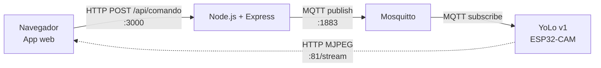
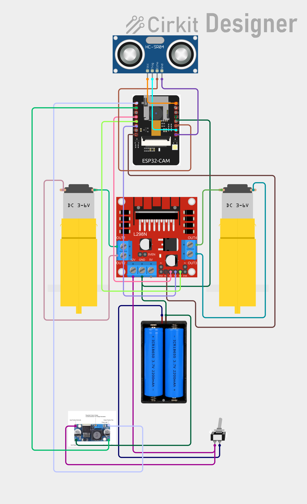

# 🤖 YoLo — Robot móvil con cámara controlado por red local


Robot móvil que se maneja desde una app web dentro de una red Wi-Fi propia, con video en vivo desde su cámara.

> Proyecto Integrador Anual — **Redes I** y **Software II**, 5.º año, Técnico en Programación
> C.T.P. "Olga B. de Arko", Ushuaia, Tierra del Fuego · 2026
> Prof. Nicolás A. Cussi

---

## Índice

1. [Versiones](#versiones)
2. [Arquitectura](#arquitectura)
3. [Hardware de YoLo v1](#hardware-de-yolo-v1)
4. [Conexiones](#conexiones)
5. [Alimentación](#alimentación)
6. [Distribución en el chasis](#distribución-en-el-chasis)
7. [Estado del armado](#estado-del-armado)
8. [Estructura del repositorio](#estructura-del-repositorio)
9. [Seguridad](#seguridad)
10. [Próximos pasos](#próximos-pasos)

---

## Versiones

| Versión | Placa | Estado |
|---|---|---|
| **YoLo v1** | ESP32-CAM sola: Wi-Fi, MQTT, video y motores | 🛠️ En armado |
| YoLo v2 | ESP32-CAM (video) + ESP32 DevKit (motores, MQTT y periféricos) | 📝 Planificada |
| Yarbi | Versión futura con audio y capacidad de responder | 💭 Idea |

## Arquitectura



- **MQTT** controla el robot. **HTTP/MJPEG** transporta el video, directo de la cámara al navegador.
- Comandos: `adelante`, `atras`, `izquierda`, `derecha`, `stop` — JSON `{"accion": "..."}`.
- Tópicos: `yolo/<id>/comando` y `yolo/<id>/estado`.

## Hardware de YoLo v1

| Pieza | Modelo | Función |
|---|---|---|
| Placa principal | ESP32-CAM AI-Thinker (OV2640) | Wi-Fi, MQTT, video y control de motores |
| Programador | ESP32-CAM-MB | Solo para programar, no va en el robot |
| Driver de motores | L298N | Puente H doble |
| Sensor | HC-SR04P (versión 3,3 V) | Anti-choque ("ojos") |
| Regulador | LM2596 (step-down) | 5 V para la ESP32-CAM |
| Motores | 2 × TT (3–6 V) | Tracción |
| Baterías | 2 × 18650 en serie (2S) | 7,4 V nominal |
| Portapilas | 2 × 18650 en serie | — |
| Interruptor | Basculante | Corta el positivo |
| Chasis | Smart Robot Car 2WD, acrílico | Un nivel, rueda loca trasera |

> Decidido para esta versión: **sin BMS, sin capacitores y sin fusible**. Ver [Seguridad](#seguridad).

## Conexiones

Diagrama completo en Cirkit Designer: 

### ESP32-CAM → L298N

| ESP32-CAM | L298N | Función |
|---|---|---|
| GPIO 4 | IN1 | Motor izquierdo |
| GPIO 13 | IN2 | Motor izquierdo |
| GPIO 14 | IN3 | Motor derecho |
| GPIO 15 | IN4 | Motor derecho |
| GND (derecho, medio) | GND | Tierra común |

- **ENA y ENB con jumper puesto.**
- **Borne 5V del L298N sin conectar.**

### ESP32-CAM → HC-SR04P

| HC-SR04P | ESP32-CAM |
|---|---|
| Vcc | **3V3** |
| Trig | GPIO 1 (U0T) |
| Echo | GPIO 3 (U0R) |
| Gnd | GND (derecho, abajo) |

### Motores → L298N

| Motor | L298N |
|---|---|
| Izquierdo | OUT1 / OUT2 |
| Derecho | OUT3 / OUT4 |

### Pines a tener en cuenta

- **Libres a propósito:** GPIO 0, 2, 12 y 16 (pines de arranque o reservados).
- **GPIO 4** también enciende el LED de flash.
- **GPIO 14 y 15** pueden dar señales al arrancar: probar con las ruedas en el aire.
- **GPIO 1 y 3** son el UART: con el sensor conectado se pierde el monitor serie. Desconectar el sensor para programar; el debug va por MQTT.

## Alimentación

```text
Batería + ──► Interruptor ──┬──► L298N 12V
                            └──► LM2596 IN+

LM2596 OUT+ (5,0 V) ──► ESP32-CAM 5V

Batería − ──┬──► L298N GND
            └──► LM2596 IN−

LM2596 OUT− ──► ESP32-CAM GND (izquierdo)
```

- 2S: **8,4 V** cargadas · **7,4 V** nominal · cortar a **6,4 V**.
- LM2596 ajustado a **5,0–5,1 V con multímetro y sin carga**, antes de conectar la placa.
- La ESP32-CAM se alimenta por el pin **5V**, nunca por 3,3 V.
- GND común entre todo.

## Distribución en el chasis

Vista superior, frente arriba:

| Zona | Componente |
|---|---|
| Frente (paragolpes) | Case con HC-SR04P + ESP32-CAM |
| Centro, entre los motores | L298N (arriba) · motores TT (abajo) |
| Detrás del L298N | Batería 2×18650 (abajo, con precintos) |
| Atrás | LM2596 e interruptor accesible · rueda loca (abajo) |

## Estado del armado

El armado sigue el [flujo de armado de robots](docs/flujo-armado-robots.md).

| Fase | Estado |
|---|---|
| 0 · Ficha del robot | ✅ |
| 1 · Kit y hardware | 🟡 Falta medir las placas con calibre |
| 2 · Diagrama | ✅ |
| 2b · Simulación en Wokwi | ⏳ |
| 3 · Alimentación | ⏳ |
| 4 · Armado en banco | ⏳ |
| 5 · Programación por capas | ⏳ |
| 6 · Pruebas | ⏳ |
| 7 · Montaje y case 3D | ⏳ |
| 8 · Documentación y cierre | ⏳ |

## Estructura del repositorio

```text
yolo/
├── docs/
│   └── flujo-armado-robots.md   # Reglas y fases de armado
├── hardware/
│   ├── diagrama-yolo-v1.png     # Diagrama exportado de Cirkit
│   └── fotos/                   # Fotos del armado
├── simulacion/                  # Proyectos de Wokwi (Fase 2b)
├── firmware/                    # Código de la ESP32-CAM (Fase 5)
├── case-3d/                     # .scad y .stl del case frontal (Fase 7)
└── README.md
```

## Seguridad

- Conectar y desconectar con el robot **apagado**.
- **Sin BMS:** medir la batería con multímetro y cargar antes de llegar a **6,4 V** (3,2 V por celda). No cargar sin supervisión. Revisar cada celda por separado: si difieren más de 0,1 V, cargarlas individualmente.
- No usar celdas hinchadas o golpeadas.
- Probar los motores con las ruedas en el aire, nunca al borde de la mesa.
- Al programar con la batería conectada: unir **solo GND, TX y RX**.
- Si la ESP32-CAM se reinicia al arrancar los motores (brownout): batería baja o falta de capacitores.

## Próximos pasos

- [ ] Medir las placas con calibre
- [ ] Simular sensor + MQTT en Wokwi
- [ ] Armar y ajustar la alimentación en banco
- [ ] Firmware por capas: Wi-Fi, MQTT, motores, sensor, anti-choque
- [ ] Case frontal en OpenSCAD

---

Proyecto educativo · C.T.P. "Olga B. de Arko" · Ushuaia, Tierra del Fuego · 2026
